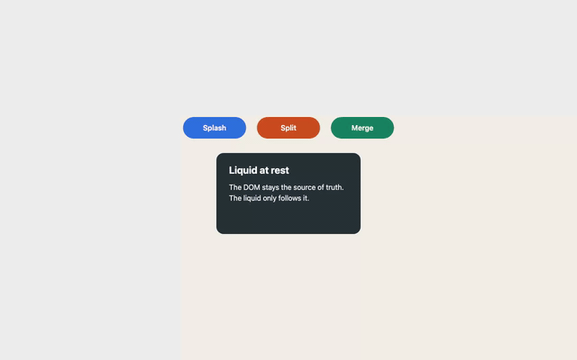
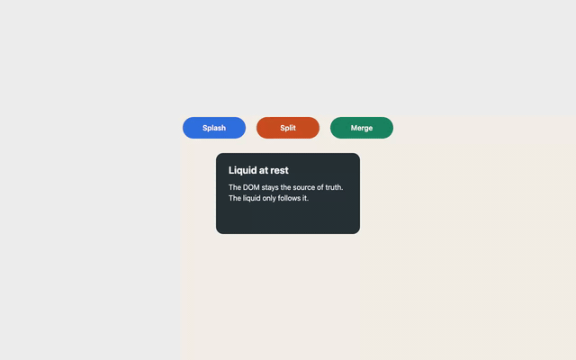

# Whole-picture check after slice 4: "Liquid text"

**Date:** 2026-10-10 · **Recorded at:** ffed60b (re-recorded after the W76 ward-review fixes; first recording at 10798cb) · **Ward:** W76
**Canonical scene and matrix:** [NORTH-STAR.md](../../NORTH-STAR.md) · **Spec:** §6 "WDD with an eye on the whole", item 4 · **Earlier checks:** [slice-2.md](slice-2.md), [slice-2-addendum.md](slice-2-addendum.md)

Recorded with `npm run whole-picture` (`e2e/record.spec.ts`, projects `record` and `record-webgpu`): Chromium, 1280×800, DPR 1, seed 1, RAF clock (a manual clock would freeze the video), GIF 640 px at 12 fps; canvas2d 1.93 MiB, 44.83 s; webgpu 2.29 MiB, 36.08 s. Timings are wall-clock, ±50 ms. Re-form budgets are read from NORTH-STAR.md (D67-1: splash 3 s, shake 3 s). Both recordings passed (`2 passed`, 1.4 min), including the live forced-colours assertion (now on `-webkit-text-fill-color`, see ## Text) and the landing `reformedAtEnd` assertion; no size fallback was needed.

GIF timelines (seconds): canvas2d step 1 idle 0–3 · step 2 sweep 3–16 · step 3 click 16.25, visually settled 17.1 · step 3b card splash 18.75, settled 19.2 · step 4 Enter on Split 21.4, settled 22.6 · step 6 shake 24.0, settled 25.3 · step 8 forced colours 28.5–29.25 · step 8 ?rm=1 29.4–35.1 · landing 35.17–44.83 (hover 35.83, click "Start free" 37.75, shake 40.0, settled 42.3); webgpu step 1 idle 0–2.4 · step 2 sweep 2.75–7.4 · step 3 click 7.92, visually settled 8.83 · step 3b 10.42, settled 11.0 · step 4 13.08, settled 14.25 · step 6 shake 15.42, settled 18.0 · step 8 forced colours 19.83–20.25 · step 8 ?rm=1 20.4–26.67 · landing 26.75–36.08 (hover 28.42, click 29.08, shake 31.42, settled 33.7).
Frame references `fNNNN` are the 12 fps extraction of each GIF (`fN` = (N − 1)/12 s); shots are `test-results/whole-picture/shots/` (`s2-` = canvas2d, the W69 prefix kept by W72; `webgpu-` = webgpu), not committed. "Visually settled" is the last frame with visible motion; the manifest re-form (restAlpha 1 everywhere) comes later and is the number the budget applies to.

Recording artefact, not a liquid fault: one washed-out grey frame appears at the same times in both videos (f0062, f0185, f0308, about every 10.25 s), independent of what the scene does. The PNG shots are clean.

## Renderers

Recorded in **canvas2d and webgpu**, the first check in both (spec §6.4). WebGPU ran on the hardware adapter (`record-webgpu`, `adapter.info`: apple / metal-3 / isFallbackAdapter false), local only (W71.0 fallback B: SwiftShader does not run the liquid in CI). SwiftShader smoke (soft, CI): pass in the first W76 run (local `webgpu` project 15 passed, 11 skipped; `adapter.info` google / swiftshader / isFallbackAdapter true; not re-run for the review fixes, which touch no renderer); green CI runs toward the 10 needed to make it blocking: 8 successful `ci.yml` runs since 2026-10-05 per `gh run list` (the smoke's own per-run result is not tallied anywhere, so 8 is an upper bound). The local `webgpu` project logged repeated `console.warn` "liquiddom: text atlas upload failed ([Invalid Texture] …)" on SwiftShader (fail-safe: the DOM text stays); see Open points.

## Scene steps

| Step | Scene step | Expected S4 | Canvas2D | WebGPU | Evidence |
|---|---|---|---|---|---|
| 1 | Idle 2 s: crisp edges, DOM text visible at rest | ✅ | ✅ crisp pills and card, DOM text, no fur, no halo at rest | ✅ identical to Canvas2D: crisp, DOM text, no liquid-text artefact | acceptance.spec step 1 ×2 pass in canvas2d and webgpu-hw; manifest at rest after 10 ms (canvas2d) and 15 ms (webgpu); GIF 0–3 s (canvas2d), GIF 0–2.4 s (webgpu); s2-step1-idle.png, webgpu-step1-idle.png |
| 2 | Pointer sweep: soft bulge, no holes | ✅ | ✅ soft drag of each pill edge as the pointer passes, no hole, slightly ragged edge while moving | ✅ same bulges, the label rides its liquid, no hole | acceptance.spec step 2 ×5 pass in both projects; sweep frames canvas2d f0037–f0191, webgpu f0034–f0090; s2-step2-sweep.png, webgpu-step2-sweep.png |
| 3 | Click "Splash": jets and fingers, [WebGPU] the text tears with the liquid, re-form within 3 s | ✅ W with text | ✅ C-shaped jets and fingers, DOM label "Splash" stays with its blue halo and reads on the bare page, re-formed in 2455 ms; step 3b card splash: the card bends with a small pale impact hole between "the" and "follows" while the DOM text stays put and readable over it (f0226–f0229, s2-step3-card-text-250ms.png), re-formed in 2222 ms | ✅ label torn away with its liquid (gone in the hole, glyph fragments on the rim, readable again before rest), DOM text back without a visible snap, re-formed in 2534 ms; step 3b: heading and paragraph shear with the card, a pale hole swallows a few letters, re-formed in 2196 ms | acceptance.spec step 3 + W74 ghost-pill tests pass (canvas2d); webgpu-robust "W74 – text that flows" 5/5 pass (webgpu-hw, no-blink MAE 0.0046, first W76 run); manifest step 3 canvas2d 2455 ms, webgpu 2534 ms; step 3b card text canvas2d 2222 ms, webgpu 2196 ms; webgpu f0096–f0099 label gone, f0100–f0101 torn glyphs on the rim, f0101–f0104 pale smear while the hole closes, f0105–f0107 readable liquid text, f0108 DOM; canvas2d f0196–f0204 halo label; s2-step3-splash-150ms.png, webgpu-step3-splash-150ms.png, s2-step3-card-text-250ms.png, webgpu-step3-card-text-250ms.png, s2-step3-reformed.png, webgpu-step3-reformed.png |
| 4 | Tab and Enter on "Split": centre splash, focus ring visible | ✅ | ✅ centred splash on Split, focus ring visible above the liquid in every frame, DOM label with halo, re-formed in 2557 ms | ✅ centred splash, focus ring visible throughout, label torn then readable, re-formed in 2414 ms | acceptance.spec step 4 pass (canvas2d); webgpu-robust W72 step 4 pass (webgpu-hw); manifest canvas2d 2557 ms, webgpu 2414 ms; canvas2d f0258–f0272, webgpu f0158–f0172; s2-step4-focus.png, webgpu-step4-focus.png, s2-step4-splash-150ms.png, webgpu-step4-splash-150ms.png |
| 5 | Drag "Merge" into the card, separate, re-form within 3 s | ⏳ | ⏳ slice 5 | ⏳ slice 5 | not recorded: liquid-only drag lands in slice 5 |
| 6 | Shake: everything sloshes, re-form within 3 s | ✅ | ✅ motion criterion met: every element sloshes (Splash and Merge thrown into arcs, card bends), DOM labels with halos, re-formed in 2487 ms. A diagonal band of diamond holes is visible ≈0.5 s in the card (f0291–f0297), at W73's gold level (lace guard f10/f20 1175/831 now vs 1171/842 at W73 gold): W73's "no diagonal lace" is not fully met; Dennis decides ✅ vs ❌ | ✅ motion criterion met: every element sloshes, the text rides and bends with its liquid, re-formed in 2479 ms. The same diagonal band of diamond holes ≈0.5 s (f0189–f0194), "source of truth" lost where the card tears; W73's "no diagonal lace" is not fully met; Dennis decides ✅ vs ❌ | acceptance.spec step 6 + lace guard pass (canvas2d, card tear px f10 1175 ≤ 1699, f20 831 ≤ 915; W73 gold 1171 / 842, `ward-073.md` gold note); webgpu-robust W72 step 6 pass; manifest canvas2d 2487 ms, webgpu 2479 ms; lace canvas2d f0291–f0297, webgpu f0189–f0194; s2-step6-shake-200ms.png, webgpu-step6-shake-200ms.png, s2-step6-reformed.png, webgpu-step6-reformed.png |
| 7 | Scroll 300 px and back: the liquid follows with no snap | ⏳ | ⏳ slice 6 | ⏳ slice 6 | not recorded: scroll lands in slice 6 |
| 8 | Modes: reduced motion, print, device.lost, forced colours | + forced-colors ✅ | ✅ seen in the recording: forced colours on live mid-splash, no canvas, black DOM text on white at once, liquid back and re-formed in 1066 ms after; ?rm=1 still and crisp after click and shake. Print rests on tests only (modes.spec "step 8 – given print media when emulated then the liquid canvas is display none"); the recording does not show it | ✅ seen in the recording: the same, no canvas, DOM text with no liquid-text hole (text fill rgba(0, 0, 0, 0) before the switch, opaque during it), re-formed in 1560 ms after; ?rm=1 still and crisp. Print and device.lost rest on tests only (modes.spec print test; webgpu-robust "step 8 (device.lost) – … continues as canvas2d on one remounted canvas …" and "W74 device.lost – … DOM text is opaque again"); the recording does not show them | modes.spec 5/5 (+2 visual skipped on macOS), a11y.spec 2/2, halo.spec 7/7, colour-refresh 2/2 (canvas2d); webgpu-robust W72 step 8 3/3 + W75 9/9 incl. test 34 forced colours live (webgpu-hw, first W76 run); recording: s2-step8-forced-colors-mid-splash.png, webgpu-step8-forced-colors-mid-splash.png, …-step8-forced-colors-after.png, …-step8-rm-idle.png, …-step8-rm-after-click-and-shake.png; GIF 28.5–29.25 s (canvas2d, f0343–f0352), GIF 19.83–20.25 s (webgpu, f0239–f0244) |

Splash scene and playground (`scenes.spec`): pass (2/2, canvas2d). Published dist (`e2e:dist`): pass (1/1, first W76 run). Landing smoke (`landing.spec`): pass (3/3, canvas2d, after the a11y fixes). Totals: canvas2d 40 passed, 9 skipped (re-run after the review fixes); first W76 run only: webgpu-hw 39 passed, 15 skipped; webgpu (SwiftShader) 15 passed, 11 skipped; cargo 170 passed, 2 ignored.

## Text

WebGPU, step 3 (12 fps frames f0094–f0109): f0096–f0099 the centre of the pill is a clean hole and the label is simply gone with it (no DOM text over the hole, no pale rest pill: D74-7 holds); f0100–f0101 torn glyph fragments ("S") sit on the closing rim; f0101–f0104 a pale, whitish smear fills the centre as the hole closes over the torn text, for about 0.3 s; f0105–f0107 "Splash" is readable in the liquid, still distorted; f0108 it is DOM text, with no blink and no sharpness snap visible between f0107 and f0108. Step 3b (f0126–f0133): the gentle card splash is the best liquid-text moment of the recording: "Liquid at rest" and both paragraph lines shear and stretch with the card, stay readable in places (webgpu-step3-card-text-250ms.png), and only a pale hole at the impact point (around "the"/"follows") swallows a few letters; by f0133 the text is crisp DOM again. Step 6 (f0186–f0217, webgpu-step6-shake-200ms.png): "Splash" stretches along the blue arc, "Merge" wraps the green V, "Split" slants, the card text tilts with the card and breaks exactly where the lace holes open ("source of truth"); a small blue tail under Splash lingers until about f0216. No stale glyph and no smear under the resting pointer were visible in any frame.

Canvas2D: the DOM text never moves; while an element moves it carries the halo in its own background colour (probe mid-shake: all four elements `liquid-halo`, text-shadow rgb(47, 111, 222) on Splash, rgb(202, 75, 32) on Split, rgb(26, 131, 97) on Merge, rgb(38, 50, 56) on the card). Every label reads on the bare page mid-motion (s2-step3-splash-150ms.png, s2-step6-shake-200ms.png, canvas2d f0196–f0204 and f0290–f0297), and the halo is gone at rest (s2-step3-reformed.png, s2-step6-reformed.png). Step 3b: the card bends and opens a small pale impact hole under "the"/"follows" while its DOM text stays still and readable (f0226–f0229, s2-step3-card-text-250ms.png). The honest cost: the label stays where the element is while its liquid is somewhere else, which reads as "text on a ghost" rather than liquid text.

Forced colours (live switch mid-splash, both renderers): the canvas disappears at once and the DOM shows black text on white system colours with nothing hidden (s2-step8-forced-colors-mid-splash.png, webgpu-step8-forced-colors-mid-splash.png; GIF f0343–f0352 canvas2d, f0239–f0244 webgpu); switched off, the liquid returns and re-forms (1066 ms canvas2d, 1560 ms webgpu). The recording now asserts the computed `-webkit-text-fill-color` of #splash, the property W74's `liquid-text` uses, instead of `color` (forced colours always force `color`, so the old check could not fail). In WebGPU the fill was rgba(0, 0, 0, 0) just before the switch and opaque during it, so the check bites; in Canvas2D there is no `liquid-text`, so the fill is opaque before and during and the check only confirms nothing hides the text.

## Landing page

`demo/scenes/landing.html` ("Riverbase", six observed elements) recorded after the acceptance scene in both renderers. Click "Start free" re-formed in 2422 ms (canvas2d) and 2348 ms (webgpu), shake in 2282 ms and 2268 ms, all within the 3 s budgets; `reformedAtEnd` true in both manifests, now asserted by the recording. The page was re-recorded after the review's a11y fixes (darker focus ring, footer contrast, h2 card titles); none of them changes what the liquid does.

What holds:
- canvas2d and webgpu at rest: the page reads as an ordinary SaaS landing page, crisp pills and cards, DOM text, no artefact (s2-landing-rest.png, webgpu-landing-rest.png; canvas2d GIF 35.17 s, webgpu GIF 26.75 s); after the shake it returns to exactly that state (s2-landing-reformed.png, webgpu-landing-reformed.png).
- webgpu shake: the wide light and tinted cards wave as sheets and their headings and two-line bodies flow with them, readable along the wave (webgpu-landing-shake-200ms.png, webgpu f0379–f0385), the strongest "liquid text" impression in the whole check.
- canvas2d shake: every label stays readable as DOM text with its halo, including "Runs while you sleep" over the page background (s2-landing-shake-200ms.png).

What breaks:
- canvas2d and webgpu: the liquid that leaves its element paints over unobserved page content. The "Start free" jet covers letters of the hero paragraph (", sh" of "shape", "kfi" of "backfills", "ca" of "scales") and the light card's white liquid washes over the page (s2-landing-shake-200ms.png, webgpu-landing-shake-200ms.png). D7 keeps the canvas below the observed elements, not below the author's in-flow text; the acceptance scene has no foreign text, so this is new evidence.
- canvas2d and webgpu: escaped liquid also covers other observed elements: the "Start free" jet and the body of "Book a demo" lie over the top of the tinted "Transform in plain SQL" card (s2-landing-shake-200ms.png, webgpu-landing-shake-200ms.png; canvas2d f0483–f0488, webgpu f0379–f0384). Not only unobserved text is affected.
- canvas2d and webgpu: lace and white streaks under shake are a wide-surface effect, not a dark-colour one: they show in the dark "Runs while you sleep" card, in "Book a demo", and in the right half of the light tinted card (s2-landing-shake-200ms.png, webgpu-landing-shake-200ms.png). "Book a demo" stays speckled for about 1.3 s after its shape is back (canvas2d f0490–f0505, webgpu f0386–f0401). W73's lace fix was tuned on the acceptance card; these elements are wider (cards) or smaller and darker (pill).
- canvas2d: while "Book a demo" is still speckled, the three cards keep ragged, furry edges instead of the crisp rest outline (canvas2d f0490–f0505, sharpest at f0498); webgpu's card edges are smooth in the same phase.
- canvas2d and webgpu: a splash on "Start free" disturbs its neighbour "Book a demo" 16 px away: white specks inside the dark pill for about 0.75 s (s2-landing-splash-150ms.png, webgpu-landing-splash-150ms.png; canvas2d f0455–f0463, webgpu f0350–f0359; in webgpu its label also wobbles). Not Canvas2D-only, as first suspected.
- canvas2d and webgpu: `.liquid-element` forces `border-color: transparent` and `box-shadow: none`, so the light card's author border (#e2e6ef) and shadow are gone even at rest; white on #f4f6fb still reads, a card that relies on its border would lose its edge (s2-landing-rest.png, webgpu-landing-rest.png).
- canvas2d and webgpu: hover on "Start free" swells the liquid but keeps the snapshotted #3b4cf5 (same blue to the eye in s2-landing-hover.png and webgpu-landing-hover.png; the first W76 run sampled rgb(59, 76, 245)), while the author CSS asks for #2a37d6, the documented `:hover` limitation (needs `refresh(el)`); the author's 160 ms background transition is invisible because the DOM background is transparent.
- webgpu: the hover swell is not even: the "Start free" pill tilts, its top edge slopes down from right to left and its label rotates with it by a few degrees (webgpu-landing-hover.png, zoomed); canvas2d's hovered pill stays level with a slightly fuzzy edge (s2-landing-hover.png).
- canvas2d and webgpu: nested backgrounds (the cards' icon chips) stay in the DOM and detach from their moving liquid (s2-landing-shake-200ms.png, webgpu-landing-shake-200ms.png); "Sign in" drifts to the top-right corner during the shake (webgpu f0379–f0385).
- webgpu: torn regions of text vanish (parts of "Book a demo" and "Runs while you sleep", webgpu-landing-shake-200ms.png), as designed (D74-4 coverage 0 when torn); canvas2d instead keeps the DOM text in place over the departed liquid.

## Carried

Carried into this check from the slice-3 and slice-4 gold notes and CONTEXT's known limitations. W76 changes no engine or renderer behaviour: each row is evidence plus one recommendation, and Dennis decides what is fixed, and whether in a fix ward before slice 5 or inside a later slice.

| Item | Evidence | Recommendation |
|---|---|---|
| Honey preset re-form (279–292 frames) | probe (manual clock, seed 1, `setMaterial` honey, splash on Splash): every restAlpha back to 1 after 285 frames in canvas2d and 285 in webgpu (shared solver), against the 180-frame budget (3 s); W73 measured 279–292 | retune `presets.honey` (raise `recovery` or lower `viscosity`) to ≤ 180 frames in a fix ward before slice 5, with a patch changeset |
| Canvas2D splats w == 0 particles | probe as briefed (opaque px around Merge after hiding it mid-shake) is confounded: hiding Merge recentres the flex row, so Split moves into the region (3091 css px canvas2d, 3093 webgpu); colour-keyed probe instead (Merge-green px on the whole canvas): 6213 / 6224 at rest, 0 in both renderers 3, 60 and 360 frames after hiding | not reproduced on this build: keep closed; add a colour-keyed guard when slice 6 brings parking |
| Shake profile varies along x only | vision: the 180 px card bends as one sheet whose vertical offset varies along x, no wave along y (canvas2d f0291–f0297, webgpu f0189–f0194, s2-step6-shake-200ms.png, webgpu-step6-shake-200ms.png); the lace holes form a diagonal band where the stretch is largest | keep: a vertical term would add stretch, and the lace (Open points) asks for less; revisit only with the lace fix |
| Pointer decay per frame, not per unit of time | `POINTER_IDLE_DECAY = 0.8`, `POINTER_IDLE_MS = 120` (pointer-tracker.ts:13–14); half-life ln 0.5 / ln 0.8 ≈ 3.1 frames = 52 ms at 60 Hz, 26 ms at 120 Hz; not measured, arithmetic only (no 120 Hz display in this run) | convert to a per-time decay (`0.8^(dt·60)`) in slice 5 with the pointer-drag work |
| runtime-truth.test.ts flake under verify load | alone 20/20 pass; under `npm run verify` 3/3 pass (the 61-file vitest run; W72: 1 failure, then 0/33) | keep and watch; an explicit timeout only if it fails again |
| DOM text contrast while the liquid is away | Canvas2D probe mid-shake: all 4 elements carry `liquid-halo` with a text-shadow in their own background colour; vision: every label readable in s2-step3-splash-150ms.png and s2-step6-shake-200ms.png; WebGPU: liquid text readable in webgpu-step3-card-text-250ms.png, torn regions vanish (webgpu-step6-shake-200ms.png); landing grey body text on the bare page reads with its dark halo (s2-landing-shake-200ms.png) | closed for the acceptance scene; what remains is design, not contrast: WebGPU torn text vanishes and Canvas2D text stays put — keep |

## Feel against the north star

WebGPU now delivers the slice-4 promise in the gentle cases: the card splash and the landing cards' wave show text that is part of the liquid, stretching and bending with it, and the return to DOM text is seamless. In the violent cases the text mostly disappears with the liquid that tears (the Splash label is gone or torn for most of a second, f0096–f0104), which is honest but reads less as "text that tears" than as "text that vanishes". Canvas2D stays honest: real DOM text with a halo, always readable, never liquid. Everything still splashes, sloshes and always re-forms within 3 s in both renderers, on the acceptance scene and on a foreign page ("T-1000" holds). What looks fake: the lace holes in the acceptance card and in wide landing surfaces, the speckled "Book a demo" after a neighbour's splash, liquid painting over the author's paragraph and over neighbouring observed elements, the tilted hover pill in WebGPU, and icon chips floating off their cards. Drag and merge (slice 5) and scroll, parking and the world (slice 6) are still to come; the landing page shows that slice 6 also has to answer how the liquid stacks against unobserved content.

## Perf

At 8000 particles in the acceptance scene, this machine Apple M4 Pro (local, not CI), from the first W76 run (the review fixes change no runtime code, so perf was not re-measured):
- canvas2d (perf project): p95 Rust `tick` per fixed step 4.12 ms (mean 3.76 ms; F every substep, D74-1; slice 2: 3.560 ms, W70: 3.75 ms), RAF p95 4.24 ms (budget ≤ 12 ms).
- webgpu (webgpu-hw, Metal): RAF p95 4.36 ms (W74: 4.33 ms, W72: 3.8 ms); overdraw mean/p95/max 182.6k / 402k / 402k fragments/frame (p50 0, n 92); text pass cost not measured separately.
- F cost (W74): every substep vs off, WASM median p95 ratio 1.125, mean 3.60 vs 4.05 ms per step (every 2nd substep not taken, ratio ≤ 1.2).
CI baseline recorded: no.

## Drift check

- Engine is MLS-MPM in Rust; soft-body identifiers: none (`grep EntityBody|PARTICLES_PER_BODY|liquid_type` in `src` and `packages/core/ts/src` is empty).
- F is render-only (never in the stress): yes, per `src/fluid/fmath.rs` and `solver.rs:705` ("never in the stress") and W74's tests; Rust scenario re-form with F in the rest criterion: splash 145 frames (D74-2), W67 evidence splash 135 + 10, shake 126 + 10.
- Renderers never touch the DOM; the runtime owns every class write (`liquid-element`, `liquid-text`, `liquid-halo`): `grep classList|setAttribute|.style.` in `renderers/` is empty.
- Only `wasm-loader.ts` imports `pkg/`: yes.
- Every visible motion comes from the solver; the text follows F, not a TS animation: yes.
- Built beyond the north star, or skipped against the S4 column: none (the landing page is a W76 test page, D76-2).

## Open points for slice 5

- Residual lace under shake in both renderers: a diagonal band of diamond holes in the acceptance card for about 0.5 s (canvas2d f0291–f0297, webgpu f0189–f0194) although the D73-3 guard passes (1175 / 831 px, W73 gold 1171 / 842), and stronger white streaks on the landing page's wide surfaces (dark card, tinted card, "Book a demo") (owner: engine, shake profile / tension; the guard covers only the acceptance card).
- A splash disturbs a neighbouring element 16 px away (landing "Book a demo" specks, both renderers; owner: engine, splash impulse radius or neighbour coupling).
- Escaped liquid paints over unobserved in-flow page text and over neighbouring observed elements (landing hero paragraph, tinted card under "Start free" and "Book a demo", both renderers; owner: runtime/stylesheet stacking, D7 scope; slice 6 world).
- WebGPU hover swell tilts the "Start free" pill instead of swelling it evenly (owner: engine/renderer, to be diagnosed; canvas2d stays level).
- Canvas2D cards keep ragged edges for about 1.3 s after the landing shake (owner: Canvas2D renderer, rest edge while restAlpha < 1).
- `.liquid-element` drops author `border-color` and `box-shadow` at rest (light card loses its edge; owner: runtime/stylesheet).
- Nested backgrounds (icon chips) detach from moving liquid (owner: atlas/renderer scope, D74-5 v1 limits).
- `:hover` background colours are not followed (needs `refresh(el)`; documented W75 limitation, the author transition is invisible).
- WebGPU: the hole-closing frames show a pale smear over torn text for about 0.3 s (f0101–f0104); owner: renderer text composite.
- SwiftShader `webgpu` project: repeated "text atlas upload failed ([Invalid Texture] …)" `console.warn` (fail-safe DOM text; owner: renderer/atlas upload on fallback adapters).
- W75 open items: test 34 (forced colours live) passed in the first W76 run (webgpu-hw 39/39), rare race still to watch; a manual `refresh(el)` cuts a running author transition (documented, kept immediate at W75 gold); container-mode DPR change is still untested in a browser (resolution query only; a manual zoom check is suggested).
- W74 carried: two atlas pages up to 2 × 64 MB at 4096²; device.lost shows one blank frame during the Canvas2D rebuild; border-box clip hides overflowing text while moving.
- Spec §7 open points still open: render scale for T0 (0.5× kept since W71), what happens to the published `0.2.0-rc.0`; F every substep vs every 2nd is closed (every substep, W74).
- SwiftShader smoke: at most 8/10 green CI runs (successful `ci.yml` runs since 2026-10-05; per-job smoke results not tallied).

## Recommendation

Fix first, then plan slice 5: a small fix ward for the residual lace on the acceptance card and on wide landing surfaces and for the neighbour disturbance (both engine, both renderers), plus the honey preset retune; decide whether the stacking against unobserved and neighbouring content and the dropped border/shadow wait for slice 6 or join that fix ward. Step 6 needs Dennis' call: the S4 criterion (everything sloshes, re-form within 3 s) is met in both renderers, so the table keeps ✅, but a diagonal band of diamond holes is visible ≈0.5 s in both renderers (canvas2d f0291–f0297, webgpu f0189–f0194), at W73's gold level (lace guard f10/f20 1175/831 now vs 1171/842 at W73 gold), so W73's "no diagonal lace" is not fully met; Dennis decides ✅ vs ❌ (W69 marked a comparable "motion yes, experience no" step ❌, `slice-2.md` step 6). The other ✅ cells in the S4 column (steps 1–4 and 8) hold in both renderers, with step 8's print and device.lost resting on tests rather than on the recording. This is a recommendation only. **Dennis decides; slice 5 is planned only after his review of this check.**
