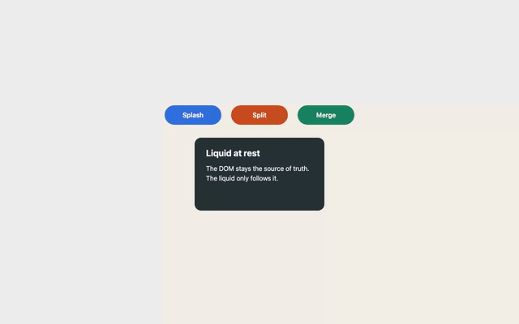
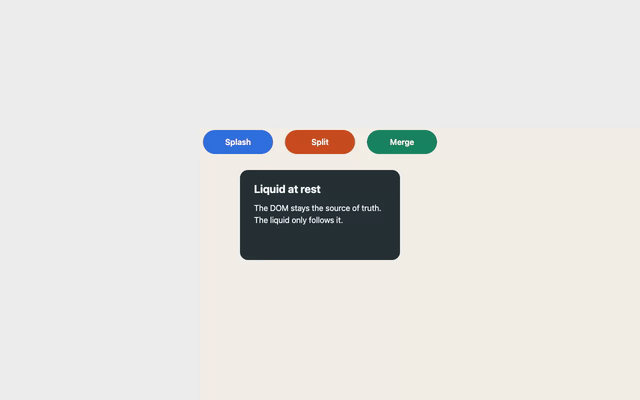
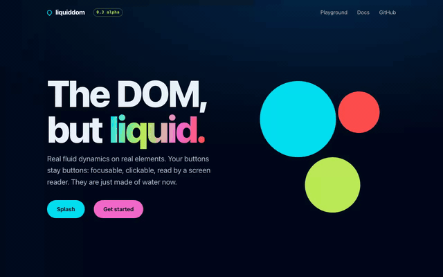
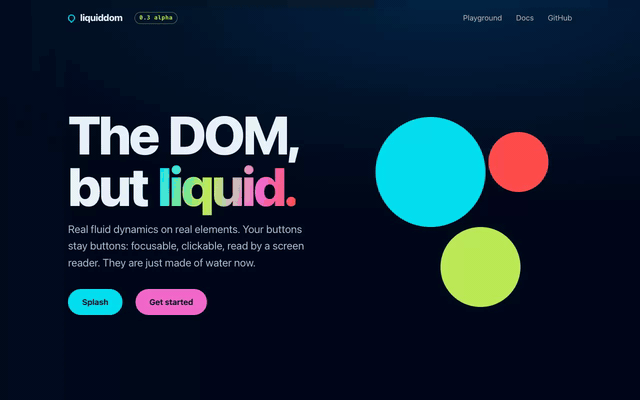

# Whole-picture check after slice 6: "The world"

**Date:** 2026-10-24 · **Recorded at:** a13137c (acceptance), b58e82f (site, re-recorded after the W87.2 review fixes) · **Ward:** W87
**Canonical scene and matrix:** [NORTH-STAR.md](../../NORTH-STAR.md) · **Slice design:** §10 · **Earlier checks:** [slice-2.md](slice-2.md), [slice-4.md](slice-4.md) (the template)






Recorded with `npm run whole-picture`. It builds the site, then runs `e2e/record.spec.ts` in the projects `record` and `record-webgpu`. Settings: Chromium, 1280×800, DPR 1, seed 1, the RAF clock, GIFs at 640 px and 12 fps. The run took 2.9 min, and each project had 2 tests passed and 2 skipped (each project skips the other renderer's tests).

| Video | Length | GIF size |
|---|---|---|
| acceptance, canvas2d | 59.1 s | 2.49 MiB |
| acceptance, webgpu | 42.3 s | 2.88 MiB |
| site, canvas2d | 38.4 s | 5.45 MiB |
| site, webgpu | 30.7 s | 5.55 MiB |

The canvas2d videos are longer because Playwright's `mouse.move` takes about 200 ms per call in the headless shell. The liquid is not the cause. Re-form budgets are read from NORTH-STAR: steps 3, 5, 6 and 7 are each 3 s. Times below come from the manifests, are wall-clock, and are accurate to about ±50 ms. "Reform" means every `restAlpha` is 1 again.

GIF timelines (seconds, read from 1-fps tiles of the videos, ±1 s):

| Segment | canvas2d | webgpu |
|---|---|---|
| Idle and sweep | 0–19 | 0–8 |
| Step 3 | 20–24 | 9–11 |
| Step 4 | 26 | 12–14 |
| Step 5 | 28–34 | 15–18 |
| Step 6 | 35 | 19 |
| Step 7 | 37–39 | 22–23 |
| Forced colours | 42 | 26 |
| `?rm=1` | 43–48 | 27–32 |
| Demo landing | 49–59 | 33–42 |

How to read the references:
- Shots live in `test-results/whole-picture/shots/` and are not committed. `s2-` is canvas2d (the prefix dates from W69); `webgpu-` is webgpu.
- The site's segment start times (ms from test start) are in `manifest-site*.json`.
- The vision pass used the shots and 2-fps tiles of the site videos.

## Renderers

The first check of all eight steps runs in both renderers.

WebGPU used the hardware adapter (`adapter.info`: apple, metal-3, `isFallbackAdapter` false). It runs only locally. Since D87-3, CI keeps the SwiftShader smoke soft for good.

The site picks its renderer with `'auto'`. The spec checks that choice per project: `getContext("2d")` on the landing canvas returns null under WebGPU, and the check runs only after the hero elements carry `liquid-element`. The site rendered in canvas2d in `record` and in webgpu in `record-webgpu`. Nothing fell back silently.

## Scene steps

| Step | Scene step | Expected S6 | Canvas2D | WebGPU | Evidence |
|---|---|---|---|---|---|
| 1 | Idle 2 s: crisp edges, DOM text visible at rest | ✅ | ✅ crisp pills and card, DOM text, no halo at rest (s2-step1-idle) | ✅ the same as canvas2d (webgpu-step1-idle) | manifest at rest after 15 ms (canvas2d) and 10 ms (webgpu); s2-step1-idle.png, webgpu-step1-idle.png |
| 2 | Pointer sweep: soft bulge, no holes | ✅ | ✅ soft bulge as the pointer passes, no hole, visible in GIF 2.5–5 s (the s2-step2-sweep shot was taken after the sweep and shows rest) | ✅ Merge swells slightly under the pointer, no hole (webgpu-step2-sweep) | s2-step2-sweep.png, webgpu-step2-sweep.png; at rest 3 ms (canvas2d) and 302 ms (webgpu) after the sweep |
| 3 | Click "Splash": jets and fingers, [WebGPU] the text tears with the liquid, re-form within 3 s | ✅ | ✅ ragged blue ring around the Splash label. The DOM label stays readable with its halo (s2-step3-splash-150ms). Card splash 3b: a small pale hole opens inside the card under "the source", and the DOM text stays put (s2-step3-card-text-250ms). Re-formed in 2381 ms; 3b in 2229 ms. | ✅ clean hole, the label goes with its liquid (webgpu-step3-splash-150ms). 3b: heading and paragraph shear with the card, and a small pale hole sits under "the" (webgpu-step3-card-text-250ms). Re-formed in 2351 ms; 3b in 2193 ms. | manifest step 3: 2381 ms / 2351 ms; 3b: 2229 ms / 2193 ms; s2-step3-reformed.png, webgpu-step3-reformed.png |
| 4 | Tab and Enter on "Split": centre splash, focus ring visible | ✅ | ✅ jets from the centre of Split, the focus ring visible above the liquid, the DOM label with halo (s2-step4-splash-150ms). Re-formed in 2337 ms. | ✅ centred splash, the focus ring visible, the label torn away with the hole (webgpu-step4-splash-150ms). Re-formed in 2311 ms. | s2-step4-focus.png, webgpu-step4-focus.png; manifest 2337 ms / 2311 ms |
| 5 | Drag "Merge" into the card and release: displacement merge, separation, both re-form within 3 s, and the labels never overlap | ✅ | ✅ Merge's home is empty and its label hidden (`liquid-away`). Its green liquid sits inside the card as a soft blob, and the card edges go ragged (s2-step5-merge-hold). After release the blob flows home without a label, and the card is still ragged (s2-step5-separate-500ms). Crisp again with Merge's label back (s2-step5-reformed). Re-formed 2292 ms after the release. No two labels overlap at any point. | ✅ the same merge. The card's top edge has a bite where Merge enters, and the card's text is cut where the two liquids meet, as D79-1 specifies, so no two labels overlap (webgpu-step5-merge-hold). After release Merge's liquid flows home with "Merge" riding on it (webgpu-step5-separate-500ms). Re-formed 2266 ms after the release. | DRAGGED (`slots()[2].interaction === 3`) was asserted mid-hold in both renderers; manifest 2292 ms / 2266 ms; s2-step5-reformed.png, webgpu-step5-reformed.png |
| 6 | Shake: everything sloshes, re-form within 3 s | ✅ | ✅ every element sloshes: Splash and Merge are thrown into arcs and the card bends as a sheet. The DOM labels keep their halo. There is no diagonal lace band in the card, which closes slice 4's ❌. A few small grey specks remain inside the card (s2-step6-shake-200ms). Re-formed in 2420 ms. | ✅ every element sloshes and the text rides and bends with its liquid. About eight small pale specks form two short vertical dotted seams through "source" and "of"; there is no lace band (webgpu-step6-shake-200ms). Re-formed in 2444 ms. | manifest 2420 ms / 2444 ms; s2-step6-reformed.png, webgpu-step6-reformed.png; slice 4 had "a diagonal band of diamond holes ≈0.5 s" in both renderers |
| 7 | Scroll 300 px and back: the liquid follows with no snap and every element is at rest within 3 s after the scroll | ✅ | ✅ three wheel notches reach exactly 300 px. The liquid stays aligned with its elements and crisp (s2-step7-scrolled-300). Back at 0 it is crisp (s2-step7-back). The lowest restAlpha during the scroll is 0.278, from W80's capped scroll inertia, but no wobble shows at 300 px. All elements at rest 38 ms after scrollY was back at 0. | ✅ aligned with no snap at 300 px. The edges are slightly ragged and the text slightly wavy from the scroll inertia (webgpu-step7-scrolled-300). Back at 0, Splash and the card are still slightly ragged (webgpu-step7-back). The lowest restAlpha during the scroll is 0. All elements at rest 263 ms after scrollY was back at 0. | scrollY went 300 then 0 (expect.poll) in both renderers; manifest 38 ms / 263 ms; `scroll.minRestDuringScroll` 0.278 / 0; budget 3000 ms; s2-step7-scrolled-300.png, webgpu-step7-scrolled-300.png, s2-step7-back.png, webgpu-step7-back.png |
| 8 | Modes: reduced motion, print, device.lost, forced colours | ✅ | ✅ forced colours switched on mid-splash: no canvas, black DOM text on white at once (s2-step8-forced-colors-mid-splash), and the liquid re-formed 914 ms after switching back. With `?rm=1` the scene is still and crisp after a click and a shake (s2-step8-rm-after-click-and-shake). | ✅ the same in webgpu (webgpu-step8-forced-colors-mid-splash), re-formed 1494 ms after switching back. `?rm=1` is still and crisp (webgpu-step8-rm-after-click-and-shake). | The recording asserts that the canvas is `display: none` under forced colours and that nothing moves under rm. Print and device.lost are covered by tests only (modes.spec; webgpu-robust step 8), and the recording does not show them. Shots: s2-step8-forced-colors-after.png, webgpu-step8-forced-colors-after.png, s2-step8-rm-idle.png, webgpu-step8-rm-idle.png. |

## Text

**WebGPU:**
- **Step 3.** The label is gone with its hole and is readable again before rest (webgpu-step3-splash-150ms).
- **Step 3b.** The card text shears with the card. A small pale hole takes a few letters (webgpu-step3-card-text-250ms).
- **Step 5** is new in this check. While Merge is held inside the card, the card's text is cut where the two liquids meet: "Liquid at re…", "The DOM … truth." The D79-1 rule holds and no two labels overlap. After release, "Merge" rides home on its liquid (webgpu-step5-separate-500ms).
- **Step 6.** The labels stretch along their arcs. The card text tilts and stays whole except where two short seams of pale specks cross "source" and "of" (webgpu-step6-shake-200ms).
- **Step 7.** The card text goes slightly wavy at 300 px, from W80's scroll inertia (webgpu-step7-scrolled-300).

**Canvas2D:**
- The DOM text never moves. Moving elements carry their halo, so every label reads mid-motion (s2-step3-splash-150ms, s2-step6-shake-200ms).
- In step 5 the dragged Merge label is hidden while away (`liquid-away`) and comes back at rest (s2-step5-merge-hold, s2-step5-reformed).

## Site

The site landing was recorded per renderer. Segment starts (ms from test start) are canvas2d / webgpu: arrival 0 / 0, idle hint 2120 / 1674, chapter 2 5844 / 5653, chapter 3 17731 / 11933, chapter 4 21588 / 15755, chapter 6 28702 / 21194, chapter 7 29937 / 22377, back to the top 33691 / 26107. GIF 0–38.4 s (canvas2d), GIF 0–30.7 s (webgpu).

- **Arrival.** 150 ms after load, the three hero drops and both pills have burst into rings with dark centres. Under webgpu the labels are torn (webgpu-site-arrival-150ms, s2-site-arrival-150ms). By 1500 ms everything is crisp and at rest in both (s2-site-arrival-1500ms, webgpu-site-arrival-1500ms). D86-4's arrival holds.
- **Idle hint.** About 4 s after load the drops go oval and the pills tilt: a gentle slosh, visible in both videos (2-fps tiles from 2.5 s to 7.5 s, fourth frame). The hero is crisp again a second later. The `site-hint` shot at 5.5 s comes after the settle, so the shot shows rest and the frames show the shake.
- **Chapter 2, "Splash all" at strength 1.**
  - webgpu: the four pills burst into fingers and droplets, and their labels go with the liquid (webgpu-site-ch2-splash-200ms).
  - canvas2d: ragged pills with the DOM labels readable over them (s2-site-ch2-splash-200ms).
- **Chapter 3, "Shake all" (0.7).** The three preset cards wobble inside their pools, and none is clipped at a pool edge after W86's 96 px padding. The webgpu text rides (webgpu-site-ch3-shake-200ms). Under canvas2d the DOM text stays put while the liquid moves, so the last body line of the water card ("a blink.") and of the jelly card ("together.") hangs below its liquid on the dark page with only its halo behind it (s2-site-ch3-shake-200ms). At rest they are crisp (s2-site-ch3-rest, webgpu-site-ch3-rest).
- **Chapter 4, drag "Drag me" onto "Merge here".** The drag is asserted under canvas2d (`liquid-away` on the pill during the hold). Under webgpu the frames show it. In both, the cyan liquid sits inside the lime card as a soft blob, and "I stay put" (`drag: false`) stays home.
  - **Finding:** the card's own text is smeared or cut while the merged liquid is inside it.
    - webgpu: "Merge here" and "Drop a pill…" are mostly cut away around the blob, with fragments on the rim (webgpu-site-ch4-merge-hold).
    - canvas2d: a notch opens from the card's left edge, and the dark page shows through up to "Drop a"; "Merge here" stays readable (s2-site-ch4-merge-hold).

  Both are crisp again at rest (s2-site-ch4-rest, webgpu-site-ch4-rest). This is the same D79-1 rule as acceptance step 5, more visible on a light card with a dark text colour.
- **Chapter 6, fast scroll to the last run card.** "Arrived at rest. Parked until you got here." is crisp about two frames after the jump, and the shot is pixel-identical to the one taken at rest (s2-site-ch6-parked-2f, s2-site-ch6-rest, webgpu-site-ch6-parked-2f). The recording shows that the card arrives at rest; that it was parked before the jump is pinned by the site e2e (`e2e/site.spec.ts`, E3), not by this recording.
- **Chapter 7, "Splash both".** The left card (motion) bursts into a ring. The right card (`forceReducedMotion: true`) stays still and crisp (s2-site-ch7-splash-200ms, webgpu-site-ch7-splash-200ms). D86-3's comparison reads as intended.
- **Back to the top.** The hero is crisp (s2-site-top, webgpu-site-top).
- **Checks at the end.** 1 body canvas and 5 pool canvases. The W72 fixture logged no `console.error` and no `pageerror`.

## Carried

| Item | Evidence | Recommendation |
|---|---|---|
| Slice 4 step 6 "motion yes, experience no" (diagonal lace band, Dennis 2026-10-10) | W77 lowered the shake (D77-2) and set `TENSION_MAX` 0.46. In this recording neither renderer shows a lace band (s2-step6-shake-200ms, webgpu-step6-shake-200ms); a faint trace remains: a few grey specks in canvas2d, two short seams of about eight pale specks in webgpu | closed; a faint seam of specks remains, judged by Dennis at gold |
| Honey re-form 279–292 frames (slice 4) | W77 retuned honey to re-form within 3 s (CLAUDE.md); not re-measured in this recording | closed by W77; no action |
| Canvas2D splats w == 0 particles | W81 skips inactive slots in Canvas2D (CLAUDE.md, Renderers) | closed |
| Pointer decay per frame | W84 made it per unit of time (D84-3) | closed |
| Landing page findings (slice 4 addendum) | W77/W82 closed them; "Book a demo" beads for ≈ 5 frames under a shake (D82-6, accepted). The demo landing re-forms its shake in 2282 ms / 2265 ms here | keep (accepted) |
| DOM text contrast while the liquid is away | canvas2d halo readable in every acceptance step; on the dark site, a body line over moving liquid is low-contrast for a few frames (W86 vision, the W75 halo) | keep; revisit with the glow and shadow ward (a halo could become a soft shadow) |

## Feel against the north star

The scene now does all eight things the north star describes, in both renderers.
- **Steps 1–4** feel as they did in slice 4.
- **Step 6** lost its lace.
- **Step 5** is the most liquid moment of the recording. The pill really flows into the card, and the two separate again.
- **Step 7** is quiet, as intended: the liquid is glued to its elements while the page scrolls. Webgpu shows a brief, soft wobble from the scroll inertia. It reads as weight, not as a snap.

The site carries the same story to a dark page, and the arrival is the strongest first impression the project has had. The weak spots are all text over moving liquid:
- the merged card's text in chapter 4;
- under canvas2d, body text left hanging below a moving card's liquid on the dark page (chapter 3).

Neither breaks a step. Both are candidates for the glow and shadow ward, which could give text over liquid a backdrop.

## Perf

Re-form times from the manifests, canvas2d / webgpu, in ms. Every budget is 3000 ms.

| Step | Canvas2D | WebGPU |
|---|---|---|
| 3 | 2381 | 2351 |
| 3b | 2229 | 2193 |
| 4 | 2337 | 2311 |
| 5 (from release) | 2292 | 2266 |
| 6 | 2420 | 2444 |
| 7 (at rest after scrollY is back at 0) | 38 | 263 |
| Demo landing splash | 2395 | 2350 |
| Demo landing shake | 2282 | 2265 |

The video's frame rate is not a perf measure (`e2e:perf` is). The canvas2d `mouse.move` latency (≈ 200 ms per call in the headless shell) stretches the canvas2d drag and the site's chapter 2 sweep in wall time, which is why canvas2d step 5 shows `reactedMs` 2626. It does not affect the re-form times, which are measured from the release.

## Epic 15

| Criterion | Status |
|---|---|
| Every step of the S6 column passes in CI on canvas2d (blocking), and in WebGPU locally on Metal at every ward's gold; the CI SwiftShader smoke stays soft | met. canvas2d is blocking in CI (PR #5 green on 44332ad, incl. the site project). `e2e:webgpu-hw` at W87 gold (Metal, 2026-10-24): 55 passed, 44 skipped, 2.0 min. A first full run under machine load had 2 flaky failures in the W78/W79 step 5 tests (a missing scene hook, then a timeout); both passed alone (2 passed, 12.6 s) and the full re-run was clean. W86's gold record does not list a webgpu-hw run (it was run in that session with the same 55/44 result but not written into ward-086.md). The criterion was amended in W87 (D87-3) |
| Whole-picture checks after slices 2, 4 and 6, recorded and inspected with vision | met with this report (slice-2.md, slice-4.md, slice-6.md) |
| No soft-body code remains; verify and clippy green | met (W66; tag `softbody-final`); verify and clippy green at W86 gold |
| The three packages published together as 0.3.0-alpha.x | open. On 2026-10-24 npm has only `0.2.0-rc.0` (`latest`) for `liquiddom`, `@liquiddom/react` and `@liquiddom/vue`. Dennis publishes (D87-4, see Release) |
| Every ward approved at gold by Dennis before complete | met through W86; W87 awaits its gold |

Epic 15 can close once the publish is done and W87 is complete.

## Release

D87-4 (Dennis, 2026-10-24): publish 0.3 under `alpha`, move `latest` to it, and deprecate `0.2.0-rc.0`. AI never runs these commands.

What the repo has today:
- `.changeset/pre.json` is in pre mode `alpha` (initial versions `0.3.0-alpha.0`, unpublished), with 19 pending changesets.
- `release.yml` runs on a pushed `v*` tag: `npm ci`, `npm run build`, then `npx changeset publish` with `NODE_AUTH_TOKEN` from the `NPM_TOKEN` secret, which exists (2026-05-23).
- The first published version will most likely be `0.3.0-alpha.1`. Read the exact version from the output of `npm run version`.

Steps, on `master` after this branch is merged:

1. Bump the versions, refresh the lockfile and commit them (by path: an untracked `.superpowers/` or other stray files must not land in the release commit):
   ```
   npm run version
   npm install --package-lock-only
   git add .changeset packages package-lock.json
   git commit -m "chore(release): 0.3.0-alpha.<n>"
   ```
2. Tag and push only that tag. `release.yml` then publishes to the `alpha` dist-tag:
   ```
   git tag v0.3.0-alpha.<n>
   git push origin master v0.3.0-alpha.<n>
   ```
3. Check the publish:
   ```
   npm view liquiddom dist-tags
   ```
4. Move `latest` to the new version:
   ```
   npm dist-tag add liquiddom@0.3.0-alpha.<n> latest
   npm dist-tag add @liquiddom/react@0.3.0-alpha.<n> latest
   npm dist-tag add @liquiddom/vue@0.3.0-alpha.<n> latest
   ```
5. Retire 0.2:
   ```
   npm deprecate liquiddom@0.2.0-rc.0 "The soft-body engine is retired; use 0.3 (npm install liquiddom@alpha)."
   npm deprecate @liquiddom/react@0.2.0-rc.0 "The soft-body engine is retired; use 0.3 (npm install @liquiddom/react@alpha)."
   npm deprecate @liquiddom/vue@0.2.0-rc.0 "The soft-body engine is retired; use 0.3 (npm install @liquiddom/vue@alpha)."
   ```
6. Check that the site's install line works: `npm install liquiddom@alpha` in an empty directory.

Until then, the live site's `npm install liquiddom@alpha` fails, and `npm install liquiddom` installs the soft-body 0.2 release candidate.

## Open points

- **Text over merged liquid** (site chapter 4, acceptance step 5 under webgpu): the card's own text is cut or smeared while another element's liquid is inside it. This is correct under D79-1, but it reads as damage on a light card. It is a candidate for the glow and shadow ward, or a later look at D79-1's band width.
- **Canvas2D body text left off its liquid** (site chapter 3, the water and jelly cards): the DOM text stays put while the liquid moves, so the last body line hangs on the dark page with only its halo. This is Canvas2D's design (the text never moves), more visible on a dark page. Same candidate.
- **Glow and shadow:** the renderer-only ward planned after W87 (a density fade for a narrow glow, a blurred coverage mask for a wide glow or a shadow).
- **Publishing (D87-4):** Dennis' steps above.
- **Recording tooling:** canvas2d `mouse.move` latency in the headless shell stretches the canvas2d video. This is harmless, and noted so it is not mistaken for liquid lag.

## Recommendation

Slice 6 is done. All eight steps are ✅ in both renderers, and step 6's slice-4 lace is gone. The site carries the engine to a real page, and parking, scroll and reduced motion all hold there.

Close the epic after Dennis publishes `0.3.0-alpha.x` (Release). Make the glow and shadow ward the next ward, with text over moving and merged liquid as its acceptance cases.
